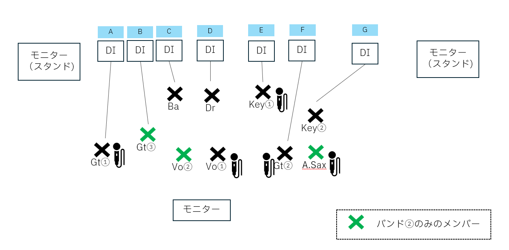

# 結婚式披露宴 バンド演奏 当日スケジュール＆進行案内

メンバーの皆様、当日はよろしくお願いいたします！  
当日のタイムスケジュールおよび演奏時のセッティング・動きについての案内です。内容のご確認をお願いいたします。

---
## 📦メインステージ備品
- 電子ドラム（Roland V-Drums TD3）
- X型キーボードスタンド　2台
- ギタースタンド 4台
- 譜面台 2台

## 📐セッティング表
### セッティング位置

※ Vo②マイクは、バンド①終了後に演者でGt①マイクを移動させて使用する

### メンバー
Gt①　牧岡さん
 Gt②　黒田さん
 Gt③　櫻井
 Key②　みゆ
 Vo①　みちるちゃん
 Vo②　みつきちゃん
 A.Sax　もえちゃん
 Drs　来田さん、板倉

## ⏰ 当日タイムスケジュール

| 時間 | 項目 | 詳細・移動 |
| :--- | :--- | :--- |
| **13:00** | **集合** | 地下2階ボールルームAB |
| **13:15〜** | **楽器セッティング** | スタッフの案内でバンケットルームへ移動 |
| - | *(結婚式参列)* | - |
| **14:40ごろ** | **受付** | ※全体受付(14:45)より少し早めにお済ませください |
| **14:45〜14:55** | **音合わせ** | ボールルームにて（新郎新婦と少し音合わせを行います） |
| **15:15** | **披露宴開始** | - |
| **16:40ごろ** | **演奏タイム 🎸** | 新郎新婦中座後の「再入場後」に実施 |

---

## 🎵 演奏タイムの詳細・動き

### 1. バンド①

* **セッティング**
  * 司会から「バンド演奏をします」と案内があったタイミングで、自席からステージへ移動し、準備を開始してください。
* **演奏進行**
  * 司会者の曲紹介（曲ふり）で演奏スタート。
  * **【2曲目から参加するメンバーの動き】**  
    1曲目が始まる前、または終わりごろに**ステージ上手（かみて）**に移動して待機をお願いします。1曲目が終了次第、登壇してください。

---

### 2. バンド②

※バンド①からバンド②への転換中、新郎新婦から少しトークが入ります。

* **セッティング**
  * バンド①の演奏終了後、すぐに登壇してセッティングを開始してください。
  * **【個人連絡 / to まめちゃん】**  
    まきおかさんのマイクをご自身の立ち位置に移動・セットをお願いします！
* **演奏進行**
  * **1曲目：** 

    * **【2曲目から参加するメンバーの動き】**  
      1曲目の開始時〜途中あたりで**ステージを降りた上手側**にて待機をお願いします。
  * **1曲目終了時：** 新郎新婦が「最後に披露する曲は〜」とトークを挟みます。
  * **2曲目：** トークの間に2曲目メンバーが登壇・セッティングを行い、完了後に2曲目のフォーメーションで演奏を開始します。

---

## 🧹 お開き後の片づけ

1. 披露宴お開き後は、一度ボールルームの外へ退出し、**ボールルーム外で待機**してください。
2. **すべてのゲストが退出された後**、再度ボールルーム内に入り、ご自身の楽器・機材のお片付けをお願いいたします。

---

ご不明点や懸念点などがあれば、お気軽にご連絡ください。当日はどうぞよろしくお願いいたします！